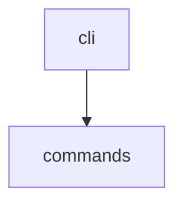

# code-to-diagram

This skill wraps the `toolkit diagram` command from the open-toolkit CLI
(https://github.com/YOUR_USERNAME/open-toolkit). It walks a directory of
`.py` files, finds which top-level local packages import which others,
and emits a Mermaid `graph TD` diagram.

## When to use this

Use this skill when the user asks things like:
- "diagram how this codebase is structured"
- "show me the module dependencies"
- "visualize the imports in this project"

## How to run it

```bash
pip install open-toolkit   # one-time
toolkit diagram /path/to/project -o diagram.md
```

Or, without installing, run the script directly:

```bash
python /path/to/open-toolkit/open_toolkit/commands/diagram.py
```

(when invoked as a library, call `build_graph(Path(root))` then
`to_mermaid(graph)` from `open_toolkit.commands.diagram`.)

## Output

A Mermaid code block like:



Paste this into any Markdown renderer that supports Mermaid (GitHub,
Notion, Obsidian, etc.) or into a Claude artifact to render it visually.

## Notes

- Only local, same-project imports are drawn — third-party packages
  (requests, numpy, ...) are intentionally excluded to keep the graph
  readable.
- This is a static heuristic (AST-based), not a full type-checker: it
  will miss dynamic imports (`importlib.import_module(name)`).
